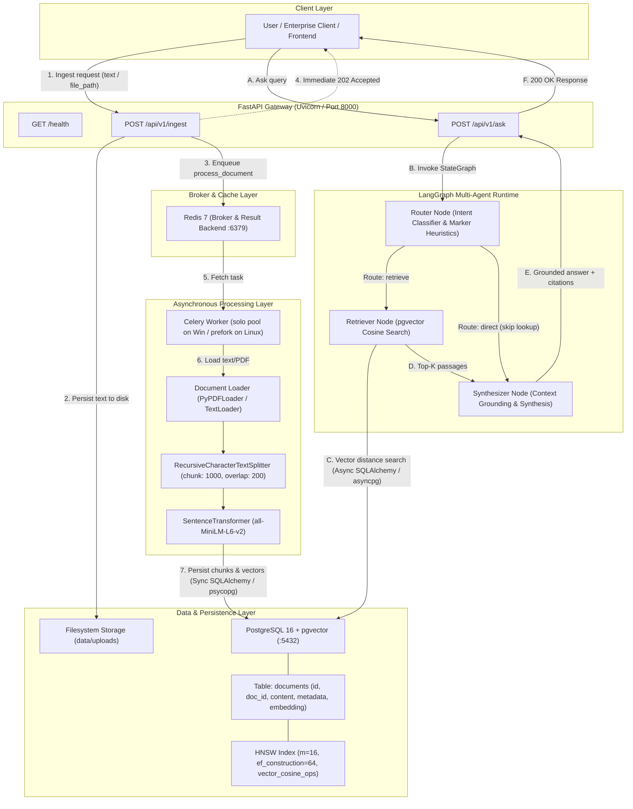
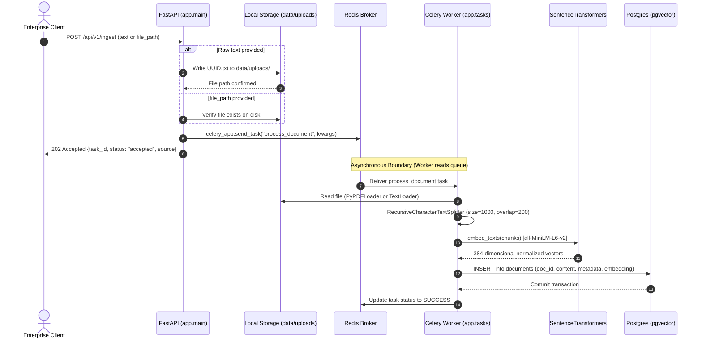
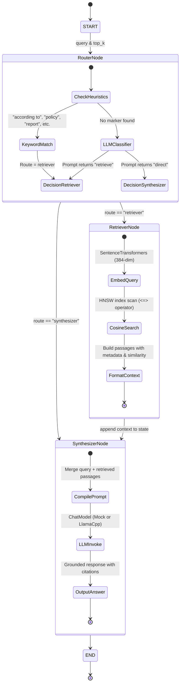
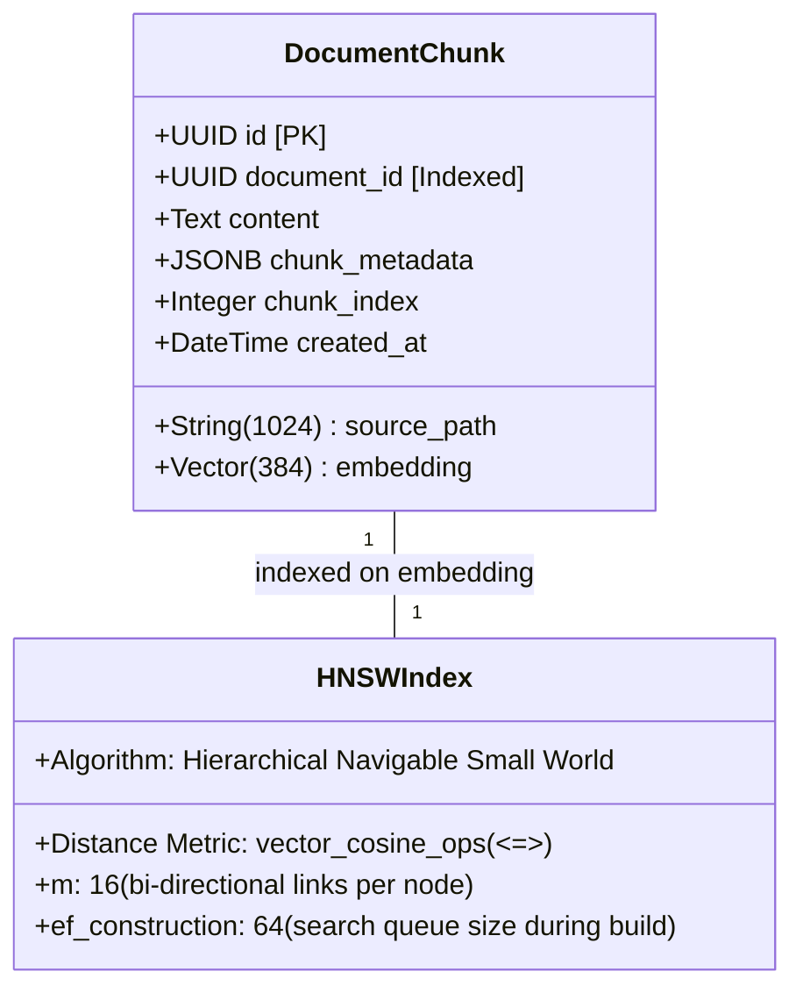

# Multi-Agent Enterprise Research & RAG API
## Complete System Architecture, Workflow Specification & Interview Preparation Guide

---

## 1. Executive Summary & Problem Statement

### 1.1 The Problem
In enterprise settings, querying unstructured documentation (policies, compliance reports, contracts, technical specifications) with raw LLMs fails due to three key obstacles:
1. **Hallucination & Lack of Auditability**: Foundation models fabricate answers when they lack proprietary internal knowledge.
2. **Context Window & Latency Bottlenecks**: Feeding entire document repositories directly into prompts is cost-prohibitive, exceeds context limits, and introduces severe latency.
3. **Synchronous Ingestion Stalls**: Chunking and embedding large enterprise corpora (PDFs, reports) in the request-response thread of a web server causes request timeouts, worker starvation, and cascading failure under traffic spikes.

### 1.2 The Solution
The **Enterprise RAG API** is an asynchronous, event-driven, multi-agent Retrieval-Augmented Generation platform built with **FastAPI**, **LangGraph**, **PostgreSQL with pgvector**, **Celery + Redis**, and **SentenceTransformers**.

It separates **heavy document ingestion** into an asynchronous Celery background worker queue (`POST /api/v1/ingest` → `202 Accepted`), while providing an intelligent, multi-agent research workflow (`POST /api/v1/ask`) governed by **LangGraph** that dynamically routes queries between vector retrieval and direct synthesis.

---

## 2. High-Level System Architecture

The following diagram illustrates the complete architectural topology, showcasing the decoupled Ingestion and Query paths, dual-engine database connectivity, and agent control flow:



---

## 3. End-to-End Workflow Lifecycles

### 3.1 Asynchronous Document Ingestion Lifecycle

The ingestion pipeline handles documents asynchronously to maintain a sub-50ms API response time regardless of document size.



#### Step-by-Step Execution Details:
1. **Request Intake**: [`app/main.py:ingest_document`](file:///c:/Users/91944/projects/enterprise-rag-api/app/main.py#L60-L82) validates input via [`IngestRequest`](file:///c:/Users/91944/projects/enterprise-rag-api/app/schemas.py#L8-L24). If raw text is provided, it is stored under `data/uploads/<uuid>.txt`.
2. **Immediate Acknowledgment**: The API enqueues the Celery task and responds with HTTP `202 Accepted` and a unique `task_id` for tracking.
3. **Document Loading**: [`app/tasks.py:_load_source_text`](file:///c:/Users/91944/projects/enterprise-rag-api/app/tasks.py#L38-L51) inspects the file suffix: `.pdf` invokes `PyPDFLoader`, while all text formats invoke `TextLoader(encoding="utf-8")`.
4. **Chunking**: `RecursiveCharacterTextSplitter` chunks the text into segments of 1000 characters with 200 characters overlap using hierarchical separators (`["\n\n", "\n", ". ", " ", ""]`).
5. **Dense Vector Embedding**: `SentenceTransformer("all-MiniLM-L6-v2")` generates 384-dimensional unit vectors (`normalize_embeddings=True`).
6. **Relational & Vector Storage**: Chunks and vectors are persisted to the `documents` table via a synchronous SQLAlchemy session using `psycopg`.

---

### 3.2 LangGraph Multi-Agent RAG Query Lifecycle

Query execution is structured as a cyclic state machine using **LangGraph**. The graph dynamically routes queries to avoid unnecessary database operations for general queries while grounding domain queries in vector context.



#### Detailed Sequence of Nodes:
1. **Entrypoint**: [`app/agent.py:run_research_graph`](file:///c:/Users/91944/projects/enterprise-rag-api/app/agent.py#L279-L290) creates the initial [`AgentState`](file:///c:/Users/91944/projects/enterprise-rag-api/app/agent.py#L24-L38):
   ```python
   AgentState = {
       "messages": [HumanMessage(content=query)],
       "query": query,
       "context": [],
       "route": "synthesizer",
       "answer": "",
       "top_k": top_k or 5
   }
   ```
2. **Router Node (`router_node`)**:
   - **Fast Heuristic Filter**: Checks for explicit document-query markers (`"according to"`, `"document"`, `"policy"`, `"report"`, `"contract"`, `"knowledge base"`, `"cite"`, `"source"`, `"summarize"`). If found, routing is immediately set to `retriever` without spending an LLM call.
   - **LLM Intent Classifier**: If no marker is present, invokes the LLM with a zero-shot classification system prompt that strictly outputs `retrieve` or `direct`.
3. **Conditional Branching (`route_after_router`)**:
   - If `retriever` → Jumps to `retriever_node`.
   - If `synthesizer` → Skips retrieval and proceeds directly to `synthesizer_node`.
4. **Retriever Node (`retriever_node`)**:
   - Computes query vector using `embed_query(query)`.
   - Executes non-blocking async SQL query:
     ```sql
     SELECT id, content, metadata, source_path, embedding <=> :query_vec AS distance
     FROM documents
     ORDER BY distance ASC
     LIMIT :k;
     ```
   - Reconstructs cosine similarity: $\text{similarity} = 1.0 - \text{distance}$.
   - Formats passages as: `[source=<path> similarity=<score>]\n<chunk_content>`.
5. **Synthesizer Node (`synthesizer_node`)**:
   - Injects retrieved context blocks into the synthesis prompt.
   - Generates the final grounded answer and stores it in `state["answer"]`.

---

## 4. Database Schema & Vector Search Internals



### 4.1 Vector Mathematics & Normalization
- **Embedding Model**: `sentence-transformers/all-MiniLM-L6-v2` maps arbitrary text into $\mathbb{R}^{384}$.
- **L2-Normalization**: At encoding time, vectors are normalized such that $\|\mathbf{u}\|_2 = 1.0$.
- **Distance Operator**: `pgvector` provides the `<=>` operator for cosine distance:
  $$\text{Cosine Distance}(\mathbf{u}, \mathbf{v}) = 1 - \frac{\mathbf{u} \cdot \mathbf{v}}{\|\mathbf{u}\|_2 \|\mathbf{v}\|_2}$$
  Because vectors are pre-normalized to unit length ($\|\mathbf{u}\| = \|\mathbf{v}\| = 1$), cosine distance simplifies to:
  $$\text{distance} = 1 - (\mathbf{u} \cdot \mathbf{v})$$
  $$\text{Cosine Similarity} = 1 - \text{distance} = \mathbf{u} \cdot \mathbf{v}$$
  Ordering by `distance ASC` ranks the most similar documents first.

### 4.2 HNSW Index Configuration
The table index is defined in [`app/models.py`](file:///c:/Users/91944/projects/enterprise-rag-api/app/models.py#L59-L69):
```python
Index(
    "ix_documents_embedding_hnsw",
    "embedding",
    postgresql_using="hnsw",
    postgresql_with={"m": 16, "ef_construction": 64},
    postgresql_ops={"embedding": "vector_cosine_ops"},
)
```
- **`m = 16`**: Maximum number of bidirectional links connected to each node in the graph layers. A value of 16 provides an optimal balance between index size, recall rate ($>98\%$), and build speed.
- **`ef_construction = 64`**: Size of the dynamic candidate priority queue evaluated during index construction. Higher values yield more accurate nearest-neighbor graphs at the expense of indexing time.
- **`vector_cosine_ops`**: Instructs Postgres to use cosine distance for graph edge calculations, directly aligning index scans with `ORDER BY embedding <=> :query_vector`.

---

## 5. Concurrency & Dual-Engine Database Architecture

A common failure mode in Python web services is mixing blocking I/O (Celery workers, heavy tools) with asynchronous event loops (FastAPI, asyncio). This project implements a **strict dual-engine pattern**:

```mermaid
flowchart LR
    subgraph AppFastAPI["FastAPI App (Async Event Loop)"]
        AsyncRoute["Endpoints / Router / Retriever"]
        AsyncEngine["create_async_engine()"]
        AsyncDriver["asyncpg (non-blocking I/O)"]
    end

    subgraph AppCelery["Celery Worker (Sync / Multiprocess)"]
        SyncTask["process_document task"]
        SyncEngine["create_engine()"]
        SyncDriver["psycopg 3 (synchronous blocking I/O)"]
    end

    subgraph PostgresDB["PostgreSQL Database"]
        SharedTables["documents table + pgvector extension"]
    end

    AsyncRoute --> AsyncEngine --> AsyncDriver -->|Connection Pool (size 10, max_overflow 20)| PostgresDB
    SyncTask --> SyncEngine --> SyncDriver -->|Connection Pool (size 5, max_overflow 10)| PostgresDB
```

- **Async Engine (`asyncpg`)**: Configured with `pool_size=10, max_overflow=20`. Used exclusively by FastAPI request handlers. When retrieving top-k chunks, the query awaits the database response without blocking the ASGI event loop, allowing the API to maintain high concurrency.
- **Sync Engine (`psycopg`)**: Configured with `pool_size=5, max_overflow=10`. Used by Celery tasks and synchronous LangChain tool invocations where tasks run in dedicated worker processes.

---

## 6. Comprehensive Interview Guide & Deep-Dive Q&A

Use this section to structure your project presentation in technical interviews.

### 6.1 The 30-Second Elevator Pitch
> *"I built an asynchronous, multi-agent enterprise RAG API designed for high-throughput document ingestion and reliable query answering. The system separates resource-intensive document ingestion into a background Celery and Redis pipeline, immediately returning HTTP 202 to prevent API thread starvation. For search and question answering, I implemented a cyclic LangGraph multi-agent architecture with a Router, Retriever, and Synthesizer. Documents are embedded with SentenceTransformers and indexed using pgvector with HNSW indexing for sub-millisecond approximate nearest-neighbor search. The database layer uses a dual-engine pattern with asyncpg for non-blocking FastAPI queries and psycopg for Celery workers."*

---

### 6.2 The 2-Minute Architectural Deep Dive
> *"When designing this architecture, I focused on three production engineering principles: decoupling heavy workloads, minimizing latency, and ensuring grounded responses.*
>
> *First, for ingestion, processing large PDFs or reports involves text extraction, chunking, and neural embeddings. Running that synchronously in a web server leads to timeouts. I decoupled this by exposing an ingest endpoint that immediately stores the document, pushes an event to a Redis broker, and responds with a 202 Accepted. A Celery worker asynchronously consumes the event, splits the text using RecursiveCharacterTextSplitter, embeds chunks with all-MiniLM-L6-v2, and batch-inserts them into Postgres.*
>
> *Second, for the query pipeline, standard RAG systems blindly perform vector retrieval on every single query—even greetings or meta-questions. I designed a LangGraph multi-agent system where a Router Node first evaluates the query. If it’s general conversation, it routes directly to synthesis, saving database I/O. If it’s domain-specific, it invokes the Retriever Node, which queries pgvector using an HNSW index configured for cosine distance.*
>
> *Finally, on the database layer, I avoided external vector SaaS platforms like Pinecone to prevent data egress and additional infrastructure overhead. Instead, I used PostgreSQL with the pgvector extension. To ensure high API concurrency, FastAPI communicates with Postgres asynchronously via asyncpg, while the Celery worker uses synchronous psycopg connections."*

---

### 6.3 Technical Interview Questions & Model Answers

#### Q1: Why did you choose `pgvector` inside PostgreSQL instead of a specialized vector database like Pinecone, Qdrant, or Chroma?
**Answer:**
1. **ACID Compliance & Single Source of Truth**: With `pgvector`, metadata, relational entities, user permissions, and embeddings live in the exact same database engine within atomic transactions. In external vector databases, updating or deleting a document requires dual-writes across two systems, risking data inconsistency.
2. **Simplified Operational Overhead**: Utilizing an existing PostgreSQL cluster avoids spinning up, securing, monitoring, and paying for separate vector infrastructure.
3. **Hybrid Querying**: `pgvector` allows combining vector similarity (`ORDER BY embedding <=> :q`) with standard relational SQL `WHERE` clauses (e.g. filtering by `tenant_id`, `created_at`, or `department`) in a single query execution plan.
4. **HNSW Indexing Performance**: With pgvector’s HNSW indexing, query latencies are competitive with specialized vector stores for datasets up to tens of millions of vectors.

---

#### Q2: What is the purpose of LangGraph here? Why not use standard LangChain LCEL chains?
**Answer:**
Standard LCEL (LangChain Expression Language) chains are **Directed Acyclic Graphs (DAGs)** designed for strictly linear execution (`Prompt | LLM | Parser`). Real-world multi-agent systems require **cyclical control flow**, conditional branching, and explicit state management:
1. **Dynamic Routing**: LangGraph’s `StateGraph` supports conditional edges (`add_conditional_edges`) where the output of the Router node conditionally determines whether the execution jumps to the Retriever or directly to the Synthesizer.
2. **Centralized Agent State**: `AgentState` uses LangGraph’s `add_messages` reducer to accumulate chat history, context passages, and routing decisions without clobbering prior steps.
3. **Extensibility for Loops & Self-Correction**: Because LangGraph supports cycles, the graph can easily be extended with a **Re-ranking Node** or a **Hallucination Grader Node** that loops back to the Retriever if the initial context score is below a threshold.

---

#### Q3: How does the HNSW index work in pgvector, and what do `m=16` and `ef_construction=64` mean?
**Answer:**
- **HNSW (Hierarchical Navigable Small World)** is an approximate nearest-neighbor graph structure inspired by skip-lists. It constructs multi-layered graphs where top layers have long-range edges for coarse exploration, and bottom layers have short-range edges for local exploitation.
- **`m = 16`**: Defines the maximum number of bidirectional edges per node. Higher values improve recall and graph connectivity on clustered high-dimensional data, but increase index RAM footprint and insertion time. 16 is the industry standard for 384-to-1536 dimension vectors.
- **`ef_construction = 64`**: Controls the size of the priority queue of closest candidate neighbors inspected while building the index. Higher values improve index quality and recall, but increase the time needed to insert chunks.

---

#### Q4: Why did you split the database connection into `async_engine` and `sync_engine`?
**Answer:**
Python's asynchronous concurrency model (`asyncio`) requires that no blocking I/O occurs on the main event loop:
- **FastAPI / API Endpoints**: Run on an `asyncio` event loop. Using `async_engine` with `asyncpg` ensures that when thousands of concurrent queries hit the API, the event loop remains unblocked while waiting for PostgreSQL results.
- **Celery Tasks**: Celery worker processes execute synchronously. Attempting to run `asyncpg` inside Celery requires creating and managing ad-hoc event loops per task, which is prone to thread deadlocks. Using `create_engine` with `psycopg` provides clean, reliable synchronous connections for background workers.

---

#### Q5: How do you prevent hallucinations in the Synthesizer Node?
**Answer:**
1. **Strict System Prompt Framing**: The Synthesizer system prompt strictly dictates that all factual claims must be grounded in the retrieved passages, and instructs the model to explicitly state if the retrieved context is insufficient rather than inventing details.
2. **Context Formatting with Provenance**: Each retrieved chunk is passed to the LLM with its exact source path and similarity score (`[source=... similarity=0.744]`), enabling the model to synthesize citation-backed answers.
3. **Similarity Threshold Filtering**: Passages with low cosine similarity (e.g. below 0.35) can be filtered before synthesis to avoid polluting the prompt with irrelevant noise.

---

#### Q6: What are the next production enhancements you would implement?
**Answer:**
1. **Hybrid Search (BM25 + Dense Vectors)**: Combine pgvector dense similarity with PostgreSQL full-text search (`tsvector` / BM25) using Reciprocal Rank Fusion (RRF) to capture exact keyword matches (part numbers, legal IDs) alongside semantic meaning.
2. **Cross-Encoder Re-Ranking**: Introduce a Cohere or FlashRank cross-encoder re-ranking step after initial retrieval to evaluate full query-passage interaction.
3. **Streaming Responses**: Use Server-Sent Events (SSE) or WebSockets in `POST /api/v1/ask` to stream token generations from the Synthesizer to the client.
4. **Tenant Isolation / Row-Level Security**: Add a `tenant_id` column to `documents` with PostgreSQL Row-Level Security (RLS) to enforce strict multi-tenant isolation.
5. **Evaluation Pipeline**: Integrate Ragas or TruLens to continuously evaluate retrieval precision, context recall, and faithfulness metrics in CI/CD.

---

## 7. Quick Reference: API Endpoints & Payloads

### Ingestion (`POST /api/v1/ingest`)
```bash
curl -X POST http://localhost:8000/api/v1/ingest \
  -H "Content-Type: application/json" \
  -d '{
    "text": "Acme Corp Policy: Remote work stipend is 150 USD per month. Data retention is 18 months.",
    "metadata": {"department": "HR", "title": "Q3 Policy"}
  }'
```
**Response** (`202 Accepted`):
```json
{
  "task_id": "ee4974db-8437-41d6-a897-31e4032bd359",
  "status": "accepted",
  "source": "data/uploads/2beaca33-e5e5-4512-b9b9-798d9dad7d5b.txt"
}
```

---

### Query (`POST /api/v1/ask`)
```bash
curl -X POST http://localhost:8000/api/v1/ask \
  -H "Content-Type: application/json" \
  -d '{
    "query": "According to the ingested document, what is the remote work stipend?",
    "top_k": 3
  }'
```
**Response** (`200 OK`):
```json
{
  "answer": "Based on the retrieved knowledge-base context: The remote work stipend is 150 USD per month for all full-time employees.",
  "query": "According to the ingested document, what is the remote work stipend?",
  "context": [
    "[source=.../2beaca33.txt similarity=0.744]\nAcme Corp Policy: Remote work stipend is 150 USD per month..."
  ],
  "used_retrieval": true,
  "route": "retriever"
}
```
